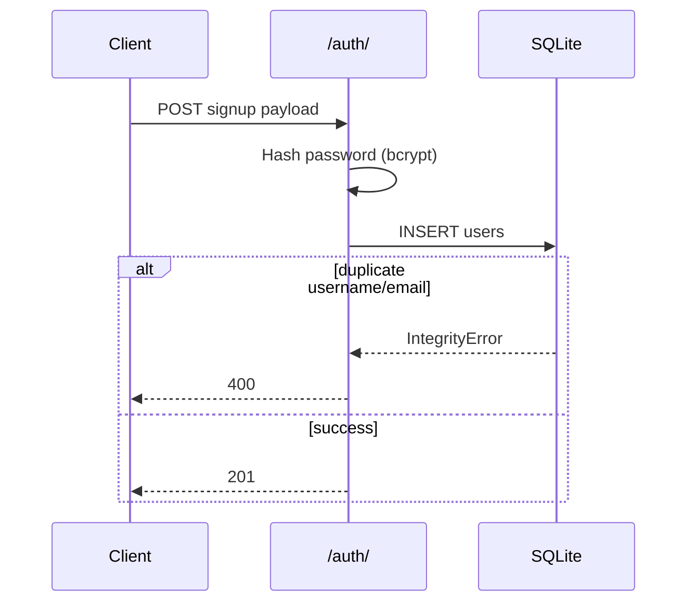
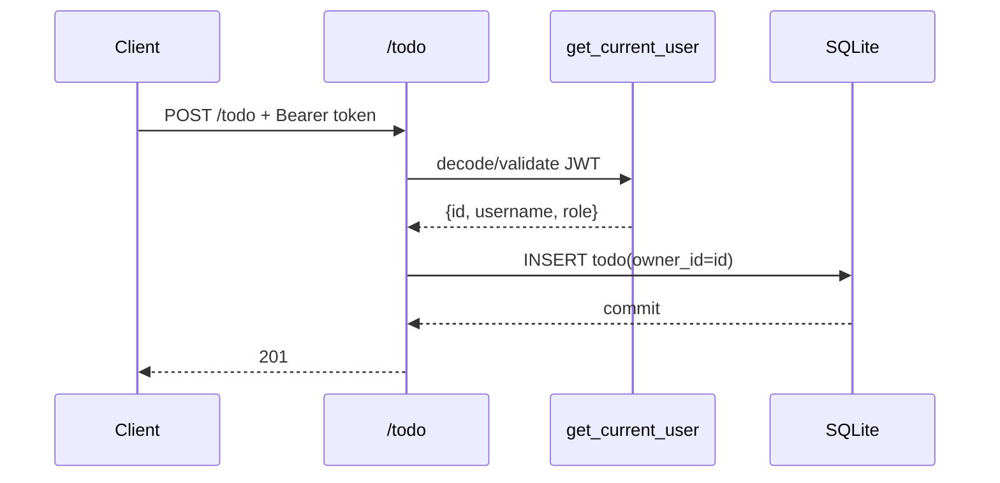
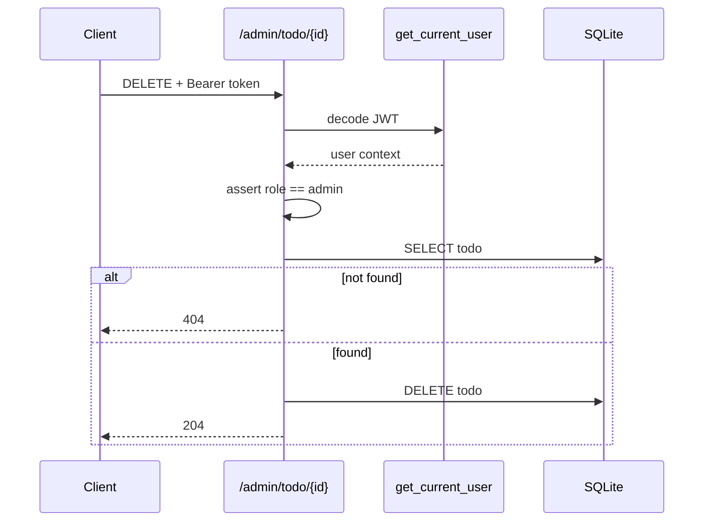

# Project 3 - FastAPI Todo API (JWT Auth + Role-Based Access)

## 1. Purpose and Scope

Project 3 is a FastAPI backend that provides:

- User registration and login with JWT-based authentication.
- User-scoped todo CRUD operations.
- Admin-only todo management endpoints.
- Password change for authenticated users.

This project is intentionally modular and split by route domains (`auth`, `todos`, `admin`, `users`) to keep concerns isolated.

---

## 2. Technology Stack

- **Framework:** FastAPI
- **ASGI Server:** Uvicorn
- **ORM:** SQLAlchemy
- **Database:** SQLite (`todosapp.db` in `Project 3/`)
- **Validation:** Pydantic
- **Auth:** OAuth2 password flow + JWT (`python-jose`)
- **Password Hashing:** Passlib + bcrypt

### Python Version

- Defined in root `pyproject.toml`: `>=3.11`

### Critical Dependency Note

- This repository pins `bcrypt==4.0.1`.
- With passlib `1.7.4`, newer bcrypt major versions can break hashing at runtime in this code path.

---

## 3. High-Level Architecture

```mermaid
flowchart LR
    C[Client]\n(Frontend, Postman, curl) --> A[FastAPI App\nmain.py]

    A --> R1[auth router\n/auth]
    A --> R2[todos router\n/]
    A --> R3[admin router\n/admin]
    A --> R4[users router\n/user]

    R1 --> J[JWT encode/decode]
    R1 --> H[Passlib bcrypt hash/verify]

    R2 --> D[(SQLite\ntodosapp.db)]
    R3 --> D
    R4 --> D

    R1 --> D
```

### Design Pattern Used

- **Router-based modular monolith**:
  - One deployable app, multiple APIRouters.
  - DB session dependency duplicated per router (same behavior everywhere).
- **Stateless auth**:
  - JWT token carries identity + role claims.
  - No server-side session table.

---

## 4. Project Structure (Project 3)

- `main.py`
  - FastAPI app creation.
  - Table auto-creation on startup (`Base.metadata.create_all(bind=engine)`).
  - Router registration.
- `database.py`
  - SQLAlchemy engine, session factory (`SessionLocal`), declarative base.
- `models.py`
  - ORM models: `Users`, `Todos`.
- `routers/auth.py`
  - Signup, login/token, current-user decoding helper.
- `routers/todos.py`
  - Authenticated user todo CRUD (owner-scoped).
- `routers/admin.py`
  - Admin-only global todo read/delete.
- `routers/users.py`
  - User profile fetch and password change.

---

## 5. Startup and Execution Flow

### App Startup

1. Python imports `main.py`.
2. `FastAPI()` app instance is created.
3. `models.Base.metadata.create_all(bind=engine)` ensures required tables exist.
4. Routers are included:
   - `auth.router`
   - `todos.router`
   - `admin.router`
   - `users.router`
5. Uvicorn starts serving requests.

### Request Lifecycle

1. HTTP request arrives at matching route.
2. FastAPI resolves dependencies:
   - DB session (`get_db`) per request.
   - Optional token dependency (`get_current_user`) for protected endpoints.
3. Route handler executes business logic.
4. SQLAlchemy query/insert/update/delete executes.
5. Session commits where needed.
6. Response serialized and returned.
7. DB session closes in `finally` block.

---

## 6. Data Model and Database Details

### 6.1 `users` table (`Users` model)

Columns:

- `id` (Integer, PK, indexed)
- `email` (String, unique)
- `username` (String, unique)
- `first_name` (String)
- `last_name` (String)
- `hashed_password` (String)
- `is_active` (Boolean, default `True`)
- `role` (String)

### 6.2 `todos` table (`Todos` model)

Columns:

- `id` (Integer, PK, indexed)
- `title` (String)
- `description` (String)
- `priority` (Integer)
- `complete` (Boolean, default `False`)
- `owner_id` (Integer, FK -> `users.id`)

### 6.3 Relationship Model

- Logical one-to-many: one user can own multiple todos.
- Implemented via foreign key only; no SQLAlchemy relationship properties configured in model classes.

### 6.4 Database Configuration

- URL: `sqlite:///./todosapp.db`
- `check_same_thread=False` enabled for SQLite + FastAPI usage pattern.
- Session config:
  - `autocommit=False`
  - `autoflush=False`

---

## 7. Authentication and Authorization

## 7.1 Auth Strategy

- OAuth2 password form at token endpoint.
- JWT signed with HS256.
- Claims:
  - `sub`: username
  - `id`: user id
  - `role`: user role
  - `exp`: token expiration

## 7.2 Token Issuance Flow (`POST /auth/token`)

1. Client sends form fields: `username`, `password`.
2. Server fetches `Users` by username.
3. Password is verified with passlib bcrypt context.
4. On success, JWT is generated with 20-minute expiration.
5. Response shape:
   - `access_token`
   - `token_type` (`bearer`)

## 7.3 Current User Resolution

- `get_current_user`:
  - Reads bearer token using `OAuth2PasswordBearer`.
  - Decodes JWT.
  - Validates required claim types (`sub` as `str`, `id` as `int`).
  - Returns dict with identity context.

## 7.4 Authorization Rules

- **Regular protected routes:** require valid token.
- **User todo routes:** enforce ownership via `Todos.owner_id == token.id`.
- **Admin routes:** require `user_role == 'admin'`.

---

## 8. API Feature Set and Endpoint Catalog

## 8.1 Auth Router (`/auth`)

- `POST /auth/`
  - Creates a user.
  - Hashes password before persistence.
  - Handles duplicate username/email via `IntegrityError` -> `400`.
- `POST /auth/token`
  - Returns bearer token on valid credentials.

## 8.2 Todo Router (root path)

- `GET /`
  - Returns all todos for authenticated user only.
- `GET /todo/{todo_id}`
  - Returns single todo for owner.
- `POST /todo`
  - Creates todo for authenticated user (`owner_id` from token).
- `PUT /todo/{todo_id}`
  - Updates owner's todo fields.
- `DELETE /todo/{todo_id}`
  - Deletes owner's todo.

## 8.3 Admin Router (`/admin`)

- `GET /admin/todo`
  - Returns all todos across all users (admin only).
- `DELETE /admin/todo/{todo_id}`
  - Deletes any todo by id (admin only).

## 8.4 User Router (`/user`)

- `GET /user/`
  - Returns current user's profile row.
- `PUT /user/password`
  - Verifies old password, then updates password hash.

---

## 9. Validation, Constraints, and Error Behavior

## 9.1 Pydantic Request Models

- `CreateUserRequest`
  - username, email, first_name, last_name, password, role
- `TodoRequest`
  - `title`: min length 3
  - `description`: min length 3, max length 100
  - `priority`: integer in range 1..5
  - `complete`: bool
- `UserVerification`
  - `password`
  - `new_password`: min length 6

## 9.2 Common Error Responses

- `401 Authentication Failed`:
  - Missing/invalid token
  - Wrong role on admin routes
- `401 Could not validate user.`:
  - Invalid credentials or JWT decode/type failure
- `404 Todo not found.`:
  - Todo id absent (or not owned for user routes)
- `400 Username or email already exists.`:
  - Duplicate unique keys at registration

---

## 10. Detailed Execution Flows

## 10.1 User Registration



## 10.2 Authenticated Todo Creation



## 10.3 Admin Todo Deletion



---

## 11. Security Notes

- Passwords are never stored in plaintext; bcrypt hashes are persisted.
- JWT expiry is enforced via `exp` claim.
- Auth secret is hardcoded in source currently; this is acceptable for learning/demo but should be moved to environment variables in production.
- Role is trusted from signed token payload and used for admin authorization.

---

## 12. Operational Notes for Fast Resume

## 12.1 How to Run (from repository root)

1. Install dependencies.
2. Start server with module path to Project 3 app.

Example:

```bash
uvicorn "Project 3.main":app --reload
```

If shell/module path quoting causes issues on your platform, run from inside `Project 3/`:

```bash
uvicorn main:app --reload
```

## 12.2 API Docs

- Swagger UI: `http://127.0.0.1:8000/docs`
- ReDoc: `http://127.0.0.1:8000/redoc`

## 12.3 First Manual Smoke Test Path

1. `POST /auth/` create user.
2. `POST /auth/token` get token.
3. Use `Authorization: Bearer <token>`.
4. `POST /todo` create todo.
5. `GET /` verify owner-scoped retrieval.

---

## 13. Current Limitations and Improvement Opportunities

- `SECRET_KEY` and token settings are in code; should be environment-driven.
- DB dependency function is duplicated across routers; can be centralized.
- No migration tool (Alembic) configured; schema evolution is manual.
- No refresh token support; access token lifetime fixed to 20 min.
- No explicit SQLAlchemy `relationship()` objects for easier ORM navigation.
- Business/domain service layer is not separated from route handlers.
- No pagination/filtering/sorting on todo list endpoints.
- Limited audit logging and observability.

---

## 14. Quick File Responsibility Map

- `main.py`: app bootstrap + router wiring + table creation.
- `database.py`: engine/session/base setup.
- `models.py`: DB schema definitions.
- `routers/auth.py`: user creation, login token, JWT decode helper.
- `routers/todos.py`: authenticated user todo CRUD.
- `routers/admin.py`: admin-only global todo access.
- `routers/users.py`: profile read + password update.

---

## 15. Summary

Project 3 is a complete learning-stage FastAPI backend that demonstrates:

- modular router organization,
- JWT authentication,
- role-based access control,
- SQLAlchemy persistence,
- and user ownership enforcement for CRUD resources.

A developer can resume by starting from `main.py` for wiring, then reading `routers/auth.py` for auth context, and finally `routers/todos.py`/`routers/admin.py` for authorization and data mutation behavior.

---

## 16. One-Page Handoff (Quick Resume)

### What this service is

- A FastAPI REST API for todos with JWT auth.
- Authenticated users manage only their own todos.
- Admin users can read and delete all todos.

### Where to start in code (in order)

| Order | File                          | Why read it                                                   |
| ----- | ----------------------------- | ------------------------------------------------------------- |
| 1     | `main.py`                     | App bootstrap, table creation, and router wiring              |
| 2     | `routers/auth.py`             | Login flow, JWT creation, token decoding (`get_current_user`) |
| 3     | `routers/todos.py`            | Owner-scoped todo CRUD implementation                         |
| 4     | `routers/admin.py`            | Role-based admin-only endpoints                               |
| 5     | `routers/users.py`            | Current user profile and password change flow                 |
| 6     | `models.py` and `database.py` | Persistence model and DB/session plumbing                     |

### Non-negotiable runtime assumptions

- `bcrypt==4.0.1` is expected with current passlib setup.
- DB is local SQLite file: `Project 3/todosapp.db`.
- JWT contains `sub`, `id`, and `role`; role drives admin access checks.

### Fast path to verify app health

| Step | Action                                                              |
| ---- | ------------------------------------------------------------------- |
| 1    | Run server                                                          |
| 2    | Create user via `POST /auth/`                                       |
| 3    | Login via `POST /auth/token` and capture token                      |
| 4    | Create todo via `POST /todo` with bearer token                      |
| 5    | Read via `GET /` and verify only owner items are returned           |
| 6    | Optional: create admin user (`role=admin`) and verify `/admin/todo` |

### If behavior seems wrong, inspect first

- Token decode + claim mapping in `routers/auth.py`.
- Ownership filters in `routers/todos.py` (`Todos.owner_id == user.id`).
- Role gate in `routers/admin.py` (`user_role == 'admin'`).

### Current architectural constraints to remember

- No Alembic migrations.
- No refresh token flow.
- Secret key is hardcoded.
- DB dependency is duplicated per router module.

---

## 17. Postman Collection Checklist

Use this as a request checklist while creating a Postman collection.

### 17.1 Collection Setup

- Collection name: `Project 3 - FastAPI Todo API`
- Base URL variable: `baseUrl = http://127.0.0.1:8000`
- Token variable: `accessToken` (empty initially)

### 17.2 Request Inventory

#### Create User

Method: `POST`  
URL: `{{baseUrl}}/auth/`  
Expected: `201`

Body (JSON):

```json
{
  "username": "user1",
  "email": "user1@example.com",
  "first_name": "User",
  "last_name": "One",
  "password": "password123",
  "role": "user"
}
```

#### Login Token

Method: `POST`  
URL: `{{baseUrl}}/auth/token`  
Body type: `x-www-form-urlencoded`  
Fields: `username=user1`, `password=password123`  
Expected: `200` with `access_token` and `token_type`

Postman Tests snippet to save token:

```javascript
pm.test("token returned", function () {
  pm.response.to.have.status(200);
  const json = pm.response.json();
  pm.expect(json.access_token).to.be.a("string");
  pm.environment.set("accessToken", json.access_token);
});
```

#### Get Current User

Method: `GET`  
URL: `{{baseUrl}}/user/`  
Auth: Bearer `{{accessToken}}`  
Expected: `200`

#### Create Todo

Method: `POST`  
URL: `{{baseUrl}}/todo`  
Auth: Bearer `{{accessToken}}`  
Expected: `201`

Body (JSON):

```json
{
  "title": "Learn FastAPI",
  "description": "Finish Project 3 flow",
  "priority": 3,
  "complete": false
}
```

#### List My Todos

Method: `GET`  
URL: `{{baseUrl}}/`  
Auth: Bearer `{{accessToken}}`  
Expected: `200`

#### Get Todo By Id

Method: `GET`  
URL: `{{baseUrl}}/todo/1`  
Auth: Bearer `{{accessToken}}`  
Expected: `200` or `404`

#### Update Todo

Method: `PUT`  
URL: `{{baseUrl}}/todo/1`  
Auth: Bearer `{{accessToken}}`  
Expected: `204` or `404`

Body (JSON):

```json
{
  "title": "Learn FastAPI Updated",
  "description": "Update completed",
  "priority": 4,
  "complete": true
}
```

#### Delete Todo

Method: `DELETE`  
URL: `{{baseUrl}}/todo/1`  
Auth: Bearer `{{accessToken}}`  
Expected: `204` or `404`

#### Change Password

Method: `PUT`  
URL: `{{baseUrl}}/user/password`  
Auth: Bearer `{{accessToken}}`  
Expected: `204` or `401`

Body (JSON):

```json
{
  "password": "password123",
  "new_password": "password456"
}
```

#### Admin - List All Todos

Method: `GET`  
URL: `{{baseUrl}}/admin/todo`  
Auth: Bearer admin token  
Expected: `200` for admin, `401` for non-admin

#### Admin - Delete Any Todo

Method: `DELETE`  
URL: `{{baseUrl}}/admin/todo/1`  
Auth: Bearer admin token  
Expected: `204` for admin, `401` for non-admin, `404` when missing

### 17.3 Negative Test Checklist

- Missing token on protected endpoint -> `401`.
- Invalid token format/signature -> `401`.
- User tries to read/update/delete another user's todo -> `404` path behavior.
- Duplicate signup username/email -> `400`.
- Invalid priority (e.g., `0` or `6`) -> `422`.
- Short `title`/`description` -> `422`.

---

## 18. Production-Hardening Checklist

The current app is suitable for learning/demo. Use this checklist to move toward production readiness.

### 18.1 Security and Secrets

- Move `SECRET_KEY` to environment variable.
- Rotate and manage keys through a secret manager.
- Add `ISS`, `AUD`, and stronger JWT claim validation policy.
- Add refresh-token strategy with revocation/rotation.
- Enforce stronger password policy and optional email verification.
- Add account lockout/rate limiting for login attempts.
- Enforce CORS policy explicitly (trusted origins only).
- Add secure headers middleware.

### 18.2 AuthZ and Identity

- Replace raw role strings with normalized enum/constants.
- Add centralized authorization utility/dependency.
- Validate `is_active` before issuing/accepting tokens.
- Consider token versioning to invalidate old tokens after password change.

### 18.3 Database and Persistence

- Migrate from SQLite to PostgreSQL/MySQL for multi-user production usage.
- Introduce Alembic migrations and migration CI checks.
- Add explicit indexes for high-read paths (`owner_id`, maybe `priority`).
- Add SQLAlchemy relationships and cascading rules where needed.
- Add backup and restore strategy.

### 18.4 API and Domain Design

- Introduce service layer to separate HTTP concerns from business logic.
- Standardize error payload schema.
- Add pagination/filter/sort to todo listing endpoints.
- Add API versioning strategy (`/api/v1/...`).
- Add idempotency considerations for critical writes.

### 18.5 Observability and Operations

- Add structured logging with request correlation IDs.
- Add metrics (latency, error rate, auth failures, DB timings).
- Add distributed tracing hooks (OpenTelemetry).
- Add health/readiness endpoints and uptime monitoring.
- Configure graceful shutdown and startup probes.

### 18.6 Testing and Quality Gates

- Add unit tests for auth helpers and permission checks.
- Add integration tests for all routes (happy + failure paths).
- Add migration tests and seed fixtures.
- Add coverage threshold in CI.
- Add static checks (ruff/flake8, mypy/pyright) and formatting checks.

### 18.7 Deployment and Configuration

- Externalize all runtime config via env vars/settings class.
- Containerize app and define reproducible image builds.
- Pin and scan dependencies for vulnerabilities.
- Add CI/CD with staging promotion and rollback strategy.
- Add environment-specific configs for dev/stage/prod.

### 18.8 Immediate Priority Order (Recommended)

1. Secret management + config externalization.

1. Database migration strategy (Alembic + production DB).

1. Test coverage for auth and authorization boundaries.

1. Logging/metrics and operational health endpoints.

1. Token lifecycle improvements (refresh + revocation).
